# DLF Schools — React (Vite) Application Architecture & Project Structure

Comprehensive technical documentation and architectural reference for the DLF Schools React + Vite frontend application.

---

## 1. Executive Summary & Tech Stack

The DLF Schools web portal is a modern, high-performance Single Page Application (SPA) designed to serve three distinct digital portals with strict content and visual isolation:
1. **Master Group Website** — Corporate leadership, group-wide vision, pedagogy, admissions, accolades, and dual-campus gateway.
2. **DLF Public School (DLPS Sahibabad)** — Branch-specific campus, CBSE & Cambridge curricula, leadership, and student life.
3. **DLF World School (DLWS Greater Noida)** — Branch-specific campus, holistic curriculum, and admissions.

### Core Technology Stack
- **Runtime & Build Tool**: [Vite 8](https://vite.dev) (ESM-native, fast HMR)
- **UI Library**: React 19 (`react` 19.2.6, `react-dom` 19.2.6)
- **Routing**: [React Router v7](https://reactrouter.com) (`react-router-dom` 7.17.0)
- **CSS & Styling**: [TailwindCSS v4](https://tailwindcss.com) with `@tailwindcss/vite`
- **Animations & Smooth Motion**: [GSAP 3.15](https://greensock.com/gsap) and [Lenis 1.3](https://lenis.darkroom.engineering)
- **Iconography**: [Lucide React](https://lucide.dev)
- **Local Dev Server Middleware**: Custom base64 media upload endpoint (`/api/upload`) saving to `public/uploads/`

---

## 2. Directory Tree & File Organization

```
DLF-school/ (Root Directory)
├── index.html                   # HTML entry point (fonts, title, root div)
├── vite.config.js               # Vite config + Tailwind v4 plugin + local upload middleware
├── package.json                 # Project dependencies and npm scripts
├── eslint.config.js             # ESLint configuration (React hooks & refresh)
├── public/                      # Static public assets (images, logos, favicon, uploads)
│   ├── images/                  # School crest, campus photos, legacy assets
│   └── uploads/                 # Local uploaded media from CMS
├── src/
│   ├── main.jsx                 # Client entry point; mounts React DOM & BrowserRouter
│   ├── App.jsx                  # Master Router, Layout coordinator & Route transition bar
│   ├── index.css                # Global styles, Tailwind v4 @theme tokens, custom scrollbar
│   │
│   ├── components/              # UI Components & Page Views
│   │   ├── Header.jsx           # Global sticky navbar, mega menu, mobile navigation
│   │   ├── Footer.jsx           # Group footer, branch quick links, contact info
│   │   ├── Hero.jsx             # Video Hero banner with title typography & action buttons
│   │   ├── Ticker.jsx           # Animated announcement ticker
│   │   ├── Stats.jsx            # Dynamic counter stats for master/branch views
│   │   ├── PortalHome.jsx       # Interactive campus switcher card gateway
│   │   ├── WhatSetsUsApart.jsx  # Core values, interactive pillars & preview sections
│   │   ├── MasterPedagogy.jsx   # Thinking School 5-stage pedagogy overview
│   │   ├── Pedagogy.jsx         # Full interactive pedagogy details view
│   │   ├── ThinkingSchool.jsx   # Dedicated Thinking School philosophy page
│   │   ├── VisionMission.jsx    # Group vision, mission, and core philosophy
│   │   ├── Management.jsx       # Board of Directors & executive leadership profiles
│   │   ├── Awards.jsx           # Group & branch honors and awards gallery
│   │   ├── Alumni.jsx           # Notable alumni showcase, stories, and network form
│   │   ├── ParentPartners.jsx   # Parent engagement programs and testimonials
│   │   ├── SchoolWinning.jsx    # Accolades, sports trophies, and recognitions
│   │   ├── VideoTestimonials.jsx# YouTube/Vimeo video modal testimonial carousel
│   │   ├── CbseResults.jsx      # Class X & XII board topper cards
│   │   ├── SchoolAcademicResults.jsx # Deep-dive academic board results
│   │   ├── OurCampus.jsx        # Branch campus facilities, 3D labs, sports arena
│   │   ├── SchoolLeadership.jsx # Branch-specific leadership & faculty heads
│   │   ├── SchoolPrincipalDesk.jsx # Principal desk editorial message & vision
│   │   ├── Admissions.jsx       # Admissions overview section
│   │   ├── AdmissionEnquiry.jsx # Digital admission registration and enquiry forms
│   │   ├── SchoolAdmissions.jsx # Branch-specific admission criteria and steps
│   │   ├── Curriculum.jsx       # Branch curriculum view (CBSE & Cambridge)
│   │   ├── Holistic.jsx         # Holistic development overview section
│   │   ├── SchoolHolistic.jsx   # Multi-pillar holistic learning experience
│   │   ├── SchoolCounselling.jsx# Mental health, pastoral care & child protection
│   │   ├── SchoolEditorials.jsx # Student articles, newsletters, and publications
│   │   ├── SchoolNews.jsx       # Press releases, school events & news cards
│   │   ├── SchoolVirtualTour.jsx# 360 degree virtual tour player
│   │   ├── Disclosures.jsx      # Branch mandatory CBSE public disclosure tables
│   │   ├── MandatoryDisclosures.jsx # Group-level statutory CBSE disclosures
│   │   ├── UsefulLinks.jsx      # Fee structures, syllabus PDFs, parent circulars
│   │   ├── CommonPages.jsx      # Careers, sports arena, and contact views
│   │   ├── ContactHome.jsx      # Interactive contact form and branch map locators
│   │   ├── SubtleGradientBackground.jsx # Ambient gradient background layer
│   │   ├── InteractiveBackground.jsx # Dynamic canvas WebGL/2D visual particle layer
│   │   ├── ScrollToTop.jsx      # Auto scroll-to-top handler upon route changes
│   │   ├── SmoothScroll.jsx     # Lenis smooth-scrolling wrapper
│   │   ├── ImageWithLoader.jsx  # Lazy loading image wrapper with skeleton loader
│   │   └── Icons.jsx            # Custom vector SVG icons
│   │
│   ├── components/school/       # Sub-modularized Branch Subsystems
│   │   ├── academic-results/    # Board cards, legacy gazette modal, showcase cards
│   │   │   ├── AcademicBoardCards.jsx
│   │   │   ├── AcademicGazetteModal.jsx
│   │   │   ├── AcademicLegacySections.jsx
│   │   │   ├── AcademicPosterModal.jsx
│   │   │   └── AcademicShowcaseCard.jsx
│   │   ├── admissions/          # Forms, fee tables, scholarship rules, procedures
│   │   │   ├── AdmissionsEnquiryForm.jsx
│   │   │   ├── AdmissionsFeeStructure.jsx
│   │   │   ├── AdmissionsProcedure.jsx
│   │   │   └── AdmissionsScholarships.jsx
│   │   ├── counselling/         # Pillars, booking modal, child safety policies
│   │   │   ├── CounsellingChildProtection.jsx
│   │   │   ├── CounsellingConsultationForm.jsx
│   │   │   ├── CounsellingLightbox.jsx
│   │   │   ├── CounsellingPillars.jsx
│   │   │   └── CounsellingUnderProgress.jsx
│   │   ├── curriculum/          # CBSE pathway, Cambridge pathway, home tabs
│   │   │   ├── CurriculumCambridgePathway.jsx
│   │   │   ├── CurriculumCbsePathway.jsx
│   │   │   └── CurriculumHomeView.jsx
│   │   ├── holistic/            # Arts, sports, social initiatives, hero banners
│   │   │   ├── HolisticAchievementsList.jsx
│   │   │   ├── HolisticHeroBanner.jsx
│   │   │   ├── HolisticHighlightCard.jsx
│   │   │   ├── HolisticLightbox.jsx
│   │   │   └── HolisticPillarsNav.jsx
│   │   └── news/                # News cards, modal reader, categorized tabs
│   │       ├── NewsArticleModal.jsx
│   │       ├── NewsCardGrid.jsx
│   │       ├── NewsHero.jsx
│   │       └── NewsUnderProgress.jsx
│   │
│   ├── admin/                   # In-App Visual Content Management System (CMS)
│   │   ├── AdminLogin.jsx       # Authentication gateway (dlf-master password lock)
│   │   ├── AdminApp.jsx         # Main CMS dashboard with live editing tabs
│   │   ├── components/          # Reusable editor widgets
│   │   │   ├── CardRepeater.jsx     # Array items manager (add, reorder, delete)
│   │   │   ├── FieldEditor.jsx      # Generic text/textarea/toggle field editor
│   │   │   ├── ImageLibraryModal.jsx# Media browser modal
│   │   │   ├── ImageUrlPicker.jsx   # Image upload & URL selection control
│   │   │   └── SaveBar.jsx          # Floating unsaved-changes action toolbar
│   │   └── sections/            # Dedicated section visual editors
│   │       ├── AwardsEditor.jsx
│   │       ├── ManagementEditor.jsx
│   │       ├── MediaLibraryEditor.jsx
│   │       ├── NewsEditor.jsx
│   │       ├── ParentPartnersEditor.jsx
│   │       ├── PillarsEditor.jsx
│   │       ├── SchoolsEditor.jsx
│   │       ├── StatsEditor.jsx
│   │       ├── TestimonialsEditor.jsx
│   │       ├── ThinkingSchoolEditor.jsx
│   │       ├── TickerEditor.jsx
│   │       ├── VideoTestimonialsEditor.jsx
│   │       └── VisionMissionEditor.jsx
│   │
│   ├── data/                    # Single Source of Truth Content Store
│   │   ├── siteData.js          # Master static content database (globalData & schoolsData)
│   │   ├── schoolsData.js       # Structured branch specifications
│   │   ├── ADMIN_SCHEMA.md      # Field schema contract for admin editable models
│   │   └── schools/             # Modularized branch data
│   │       ├── dlps/            # DLPS Sahibabad data modules
│   │       ├── dlws/            # DLWS Greater Noida data modules
│   │       └── shared/          # Shared curriculum and holistic constants
│   │
│   ├── hooks/
│   │   └── useSiteData.js       # Reactive data bridge hook (defaults + localStorage overrides)
│   │
│   └── utils/
│       └── videoHelper.js       # Video URL parser (YouTube/Vimeo embeds & thumbnails)
```

---

## 3. Application Lifecycle & Routing Architecture

### Entry Point & Mounting
1. **`index.html`**: Defines the document viewport, preloads Google Fonts (*Fira Sans*), and mounts `<div id="root">`.
2. **`src/main.jsx`**: Initializes the React 19 application via `createRoot` within `<StrictMode>` wrapped in React Router's `<BrowserRouter>`.
3. **`src/App.jsx`**:
   - Manages top-level routing with `<Routes>` and `<Route>`.
   - Mounts global layout elements: `<SubtleGradientBackground />`, glowing top progress bar during route changes, `<ScrollToTop />`, `<Header />`, and `<Footer />`.
   - Lazily loads `<AdminLogin />` and `<AdminApp />` to keep the public bundle lean.

### Complete Route Map

#### 1. Master Group Portal Routes
| Route | Component | Description |
|---|---|---|
| `/` | `MasterHome` | Group homepage: Hero, Ticker, Stats, Awards, Video Testimonials, Pedagogy, School Gateway, What Sets Us Apart, Admissions, Contact |
| `/thinking-school` | `ThinkingSchool` | Philosophy of cultivating thinking habits |
| `/vision-mission` | `VisionMission` | Mission, Vision, and Motto |
| `/parent-partners` | `ParentPartners` | Collaboration with parents |
| `/pedagogy` | `Pedagogy` | 5-stage pedagogy framework |
| `/pedagogy/:stageId` | `Pedagogy` | Stage-specific pedagogy view |
| `/what-sets-us-apart` | `WhatSetsUsApart` | Differentiators and core values |
| `/management` | `Management` | Board of Governors & Leadership profiles |
| `/awards` | `Awards` | Group accolades and national honors |
| `/news` | `SchoolNews` | Group press releases and notices |
| `/alumni` | `Alumni` | Alumni profiles, network, and registration |
| `/careers` | `CommonPages` | Job openings and teacher recruitment |
| `/sports-arena` | `CommonPages` | Athletic facilities and infrastructure |
| `/counselling` | `SchoolCounselling` | Counselling and pastoral care |
| `/useful-links` | `UsefulLinks` | Quick portals and resources |
| `/admission-enquiry` | `AdmissionEnquiry` | Central admission enquiry form |
| `/admissions` | `Navigate` | Redirects to `/admission-enquiry` |
| `/mandatory-disclosures` | `MandatoryDisclosures`| Statutory CBSE group compliance |
| `/virtual-tour` | `SchoolVirtualTour` | Interactive virtual tour |
| `/contact` | `CommonPages` | Master contact view |

#### 2. Dynamic School Branch Routes (`/school/:schoolId/*`)
`:schoolId` dynamically resolves to `dlf-sahibabad` or `dlf-greater-noida`:

| Route | Component | Description |
|---|---|---|
| `/school/:schoolId` | `Home` | Branch homepage (Hero, Stats, CBSE Results, Testimonials, Curriculum preview, Holistic, Admissions) |
| `/school/:schoolId/campus` | `OurCampus` | Campus facilities, labs, sports complexes |
| `/school/:schoolId/leadership` | `SchoolLeadership` | Branch principal and academic heads |
| `/school/:schoolId/principal-desk` | `SchoolPrincipalDesk` | Desk note from the campus principal |
| `/school/:schoolId/admissions` | `SchoolAdmissions` | Branch fees, eligibility, and process |
| `/school/:schoolId/curriculum` | `Curriculum` | Academic pathways overview |
| `/school/:schoolId/curriculum/:pathway` | `Curriculum` | Specific pathway (e.g. `cbse`, `cambridge`) |
| `/school/:schoolId/curriculum/academic-results`| `SchoolAcademicResults` | Class X & XII results and toppers |
| `/school/:schoolId/holistic-learning` | `SchoolHolistic` | Sports, arts, clubs, activities |
| `/school/:schoolId/winning-school` | `SchoolWinning` | Inter-school wins and sports awards |
| `/school/:schoolId/editorials` | `SchoolEditorials` | Student publications and essays |
| `/school/:schoolId/disclosures` | `Disclosures` | Branch CBSE mandatory disclosures |
| `/school/:schoolId/useful-links` | `UsefulLinks` | Branch circulars and fee books |
| `/school/:schoolId/virtual-tour` | `SchoolVirtualTour` | 360-degree interactive campus tour |
| `/school/:schoolId/contact` | `CommonPages` | Branch address and contact info |

#### 3. Administrative Portal Routes
| Route | Component | Description |
|---|---|---|
| `/admin/login` | `AdminLogin` | Password-protected admin gate |
| `/admin/*` | `AdminApp` | Visual CMS dashboard for editing site content |

---

## 4. Website Flow & User Journey Architecture

The DLF Schools portal is architected with a multi-tiered funnel: users arrive at either the unified **Master Group Portal** or directly at a **Branch Portal** via deep links. The architecture guides visitors from discovery and validation through to admission conversions or administrative management.

### 4.1 Master Information Architecture & User Journey Diagram

```mermaid
flowchart TD
    %% Entrances
    Visitor([🌐 Website Visitor]) --> LandingChoice{Entry Point}
    
    %% Master Flow
    LandingChoice -->|Group URL /| MasterHome["🏠 Master Group Home (/)"]
    LandingChoice -->|Branch URL /school/:schoolId| BranchHome["🏫 Dynamic Branch Home (/school/:schoolId)"]
    
    %% Master Portal Sections
    subgraph MasterPortal ["Master Group Portal Flow"]
        MasterHome --> M_Hero["1. Video Hero Banner"]
        M_Hero --> M_Ticker["2. Ticker Announcements"]
        M_Ticker --> M_Stats["3. Group Statistics & Milestones"]
        M_Stats --> M_Awards["4. School Awards & Accolades"]
        M_Awards --> M_Testimonials["5. Video Testimonials Carousel"]
        M_Testimonials --> M_Pedagogy["6. 5-Stage Thinking Pedagogy Preview"]
        M_Pedagogy --> M_Portal["7. Dual-Campus Gateway (PortalHome)"]
        M_Portal --> M_Differentiators["8. What Sets Us Apart"]
        M_Differentiators --> M_Admissions["9. Admissions Overview"]
        M_Admissions --> M_Contact["10. Group Contact & Location"]
    end
    
    %% Master Deep Links
    MasterPortal -.-> GroupPages["Master Academic & Group Sub-Pages"]
    GroupPages --> ThinkingSchool["/thinking-school (Thinking Habits)"]
    GroupPages --> VisionMission["/vision-mission (Ethos & Core Values)"]
    GroupPages --> Management["/management (Board of Governors)"]
    GroupPages --> PedagogyFull["/pedagogy & /pedagogy/:stageId"]
    GroupPages --> AwardsFull["/awards (National/Global Accolades)"]
    GroupPages --> AlumniNet["/alumni (Directory & Registration)"]
    GroupPages --> ParentPartners["/parent-partners (Parent Engagement)"]
    GroupPages --> NewsPress["/news (Press Releases & Media)"]
    GroupPages --> MandatoryDisclosures["/mandatory-disclosures (CBSE Compliance)"]
    
    %% Gateway to Branches
    M_Portal -->|Select DLPS Sahibabad| DLPS["DLF Public School, Sahibabad (/school/dlf-sahibabad)"]
    M_Portal -->|Select DLWS Greater Noida| DLWS["DLF World School, Gr. Noida (/school/dlf-greater-noida)"]
    
    %% Dynamic Branch Subsystems
    subgraph BranchPortal ["Dynamic Branch Portal Experience (/school/:schoolId)"]
        BranchHome --> B_Hero["Branch Hero & Heritage Badge"]
        B_Hero --> B_Vision["Branch Vision & Principal Desk Preview"]
        B_Vision --> B_Stats["Campus Stats & Achievements"]
        B_Stats --> B_Toppers["CBSE Board Results & Toppers"]
        B_Toppers --> B_CurriculumPreview["Curriculum Pathways Preview"]
        B_CurriculumPreview --> B_HolisticPreview["Holistic Education & Sports Arena"]
        B_HolisticPreview --> B_TourPreview["360° Virtual Tour Preview"]
        B_TourPreview --> B_CTA["Admissions & Enquiry CTA"]
        
        %% Deep Branch Sub-Routes
        BranchHome --> B_Campus["/campus (Facilities & Labs)"]
        BranchHome --> B_Leadership["/leadership & /principal-desk"]
        BranchHome --> B_Curriculum["/curriculum (CBSE / Cambridge)"]
        B_Curriculum --> B_Results["/curriculum/academic-results (Gazettes & Posters)"]
        BranchHome --> B_Holistic["/holistic-learning (Arts, Sports, Clubs)"]
        BranchHome --> B_Winning["/winning-school (Sports & Accolades)"]
        BranchHome --> B_Editorials["/editorials (Student Publications)"]
        BranchHome --> B_Disclosures["/disclosures (CBSE Mandatory Tables)"]
        BranchHome --> B_Links["/useful-links (Portals & Circulars)"]
        BranchHome --> B_Tour["/virtual-tour (Interactive Campus 360°)"]
        BranchHome --> B_Admissions["/admissions (Eligibility, Fees, Process)"]
    end
    
    %% Conversion Funnel
    B_Admissions --> EnquiryForm["📝 Digital Admission Enquiry (/admission-enquiry)"]
    M_Admissions --> EnquiryForm
    EnquiryForm --> Confirmation["✅ Registration Confirmation & Followup"]
    
    %% Administrative Flow
    Visitor -.->|Access /admin| AdminGate{"Admin Login Gate"}
    AdminGate -->|Unauthenticated| AdminLogin["/admin/login (Password: dlf-master)"]
    AdminGate -->|Authorized| AdminApp["/admin CMS Dashboard"]
    AdminApp --> CMS_Global["Edit Global Sections (Ticker, Stats, Awards, etc.)"]
    AdminApp --> CMS_Schools["Edit School Data (Sahibabad vs Gr. Noida)"]
    AdminApp --> CMS_Media["Upload Media & Photos to /public/uploads/"]
```



---

### 4.2 Step-by-Step Persona User Journeys

#### Journey 1: Prospective Parent (Admissions & Discovery Funnel)
1. **Discovery**:
   - Parent arrives on the Master Homepage (`/`).
   - Watches the full-bleed video Hero and scans key statistics (30+ Years Legacy, #1 in Ghaziabad).
   - Validates institutional excellence via **School Awards** (`SchoolWinning`) and **Video Testimonials**.
2. **Campus Selection**:
   - Reaches the **Campus Gateway** (`PortalHome`) and selects either **DLPS Sahibabad** or **DLWS Greater Noida**.
   - URL transitions seamlessly to `/school/:schoolId` with glowing route-loader feedback.
3. **Branch Deep-Dive**:
   - **Academic Rigor**: Navigates to `/school/:schoolId/curriculum` to inspect the CBSE or Cambridge International pathways. Clicks into `/academic-results` to view Class X/XII toppers and open the board gazette in `AcademicGazetteModal`.
   - **Campus Life**: Visually inspects physics/robotics labs and athletic facilities at `/school/:schoolId/campus`, followed by an interactive 360° tour at `/school/:schoolId/virtual-tour`.
   - **Leadership Trust**: Reads the Principal's editorial note at `/school/:schoolId/principal-desk` and faculty leadership profiles at `/school/:schoolId/leadership`.
4. **Conversion (Application)**:
   - Clicks "Admissions" to visit `/school/:schoolId/admissions` to check age criteria, fee schedule tables, and scholarship programs.
   - Clicks "Apply Now" to load the interactive digital form at `/admission-enquiry`, submits student details, and receives instant on-screen confirmation.

#### Journey 2: Enrolled Parent & Current Student (Daily Academic Portal)
1. **Notice Board & Circulars**:
   - Parent visits `/school/:schoolId/useful-links` to download monthly circulars, fee books, and examination schedules.
2. **Student Achievements & Publications**:
   - Student visits `/school/:schoolId/editorials` to read student council essays, literary publications, and school newsletters.
   - Visits `/school/:schoolId/holistic-learning` to view clubs, social service projects, and sports tournaments with full-screen image lightboxes.
3. **Pastoral Care & Child Wellness**:
   - Parent/Student visits `/counselling` (or `/school/:schoolId/counselling`).
   - Reads child protection policies, pastoral care guidelines, and books a confidential consultation via `CounsellingConsultationForm`.
4. **Statutory Verifications**:
   - Parent verifies CBSE compliance, teacher ratios, and safety certificates via `/school/:schoolId/disclosures`.

#### Journey 3: Alumni Network & Engagement
1. **Alumni Hub**:
   - Former student visits `/alumni`.
   - Reads featured alumni success stories across entrepreneurship, research, and public service.
2. **Registration**:
   - Fills out the Alumni Network Registration form to receive homecoming invitations and mentor current students.

#### Journey 4: Administrative CMS Content Lifecycle
1. **Access Control**:
   - Content manager navigates to `/admin`.
   - If not authenticated, the route redirects to `/admin/login`, requiring password verification (`dlf-master`).
2. **Content Editing**:
   - Admin opens the desired section tab:
     - **Global Content**: Ticker announcements, national awards, group vision, management board bios.
     - **School-Specific Content**: Campus gallery images, admission fees, scholarship matrices, and principal notes for either Sahibabad or Greater Noida.
3. **Media Uploading**:
   - Uses `ImageUrlPicker` to upload photos directly through the local Vite development endpoint (`/api/upload`) saving to `public/uploads/`.
4. **Saving & Live Preview**:
   - Floating `SaveBar` detects unsaved edits and saves changes to `localStorage` via `useSiteData()`, updating live previews instantly without page reloads.

---

### 4.3 Modal & Overlay Interaction Loops

The application utilizes high-engagement modal experiences to provide deep content without breaking user navigation state:

| Modal Component | Trigger | Purpose & Experience |
|---|---|---|
| `AcademicGazetteModal` | "View Full Result Gazette" in Academic Results | Full-screen high-resolution PDF/image viewer with page controls for official CBSE board gazettes. |
| `AcademicPosterModal` | Clicking any topper card in Academic Results | Spotlight modal displaying student score cards, percentages, subject distinctions, and photos. |
| `VideoTestimonials` | Clicking video cards on Master or Branch Home | Responsive video overlay embedding YouTube/Vimeo players with autoplay and backdrop blur. |
| `NewsArticleModal` | "Read Full Notice" in `/news` grid | Slide-in modal displaying full press releases, event schedules, and downloadable attachments. |
| `HolisticLightbox` | Photo galleries in `/holistic-learning` | Clean lightbox with gesture-friendly image zoom and caption details. |
| `CounsellingConsultationForm` | "Schedule Consultation" in Counselling | Multi-step appointment request form for parents and students. |

---

### 4.4 Global Navigation & Campus Switcher Mechanics

1. **Header Context Awareness**:
   - `<Header />` detects current URL (`useLocation()`).
   - If path begins with `/school/:schoolId`, the header adapts its branding badge, accent colors (Green for Sahibabad, Purple for Greater Noida), and contextual navigation links (Campus, Leadership, Admissions, Curriculum).
   - If path is on root `/` or group pages, it renders the Master Group navigation (Pedagogy, Thinking School, Management, Portal Gateway).
2. **Dynamic Campus Switcher**:
   - Dropdown control in `<Header />` allows one-click switching between **DLF Public School (Sahibabad)**, **DLF World School (Gr. Noida)**, and **DLF Group Master**.
   - Context is preserved: switching branches while exploring curriculum stays within the curriculum view for the chosen branch.
3. **Mobile Navigation Drawer**:
   - Hamburger button triggers a fluid GSAP-animated full-screen drawer with nested accordions for sub-page links and quick contact CTAs.

---

## 5. State Management & CMS Data Architecture

### Single Source of Truth (`src/data/siteData.js`)
All dynamic texts, hero titles, statistics, accolades, and member bios are centralized in `src/data/siteData.js` exporting:
- `globalData`: Master site content (ticker, stats, management, awards, pedagogy, news, testimonials).
- `schoolsData`: Isolated content configurations for each branch (`dlf-sahibabad`, `dlf-greater-noida`).

### Data Bridge Hook (`src/hooks/useSiteData.js`)
Components access CMS content through `useSiteData()`:
```javascript
import { useSiteData } from '../hooks/useSiteData'

export default function MyComponent() {
  const { global, schools, save, reset } = useSiteData()
  const tickerItems = global.ticker.items
  const sahibabadData = schools['dlf-sahibabad']
  // ...
}
```
**Mechanism:**
1. Loads static defaults from `siteData.js`.
2. Reads `localStorage` keys (`dlf_admin_global`, `dlf_admin_schools`) for overrides saved via the in-app CMS.
3. Performs a deep-merge: defaults are preserved while user edits overwrite specific fields.
4. Exposes `save(sectionKey, data)` and `reset(sectionKey)` for the CMS.

---

## 6. Design System & Styling Tokens

Styling is handled via **TailwindCSS v4** using the `@theme` directive in `src/index.css`:

```css
@theme {
  --color-brand-greenDeep: #2B5126;       /* DLPS primary heritage green */
  --color-brand-greenVibrant: #009E49;    /* Bright green accent */
  --color-brand-purpleDeep: #463676;      /* DLWS primary regal purple */
  --color-brand-purpleVibrant: #5E2C84;   /* DLWS energetic purple */
  --color-brand-masterDeep: #0F172A;      /* Master portal slate navy */
  --color-brand-masterVibrant: #1E293B;   
  --color-brand-gold: #C59B27;            /* Prestige gold accent */
  --color-brand-goldlight: #E6B83C;       /* Soft gold highlight */
  --color-brand-bg: #FAF8F5;              /* Cream / Warm off-white */
  --color-brand-card: #FFFFFF;            /* Pure white surface */
  --color-brand-charcoal: #1E2522;        /* Editorial body text */
  --color-brand-muted: #616A66;           /* Subtle meta text */

  --font-serif: "Fira Sans", sans-serif;
  --font-sans: "Fira Sans", sans-serif;
  --font-fira: "Fira Sans", sans-serif;
}
```

### Visual Enhancements
- **Ambient Glows**: Radial gradient glows (`.ambient-glow-1`, `.ambient-glow-2`) provide subtle depth.
- **Noise Overlay**: SVG fractal noise (`.noise-overlay`) creates an editorial print texture.
- **Top Route Loader**: Dynamic glowing progress bar triggers on every route transition.

---

## 7. Strict Site Isolation & Master Site Security Lock

1. **Three-Way Strict Isolation Policy**:
   - Master Group Website, DLPS Sahibabad, and DLWS Greater Noida must remain strictly isolated.
   - School branch pages must never display or import Master Executive Director profiles.
   - DLPS and DLWS must never share or leak branch-specific leadership or data.
2. **Master Site Password Lock**:
   - Changes to the Master Group Website require explicit authorization with password `dlf-master`.

---

## 8. Developer Commands & Workflows

```bash
# Install dependencies
npm install

# Start Vite development server (port 5173 by default)
npm run dev

# Build production bundle into /dist
npm run build

# Preview the production build locally
npm run preview

# Run ESLint across all files
npm run lint
```

